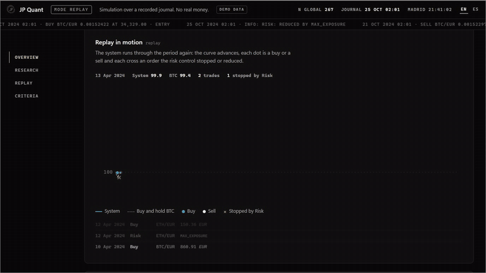
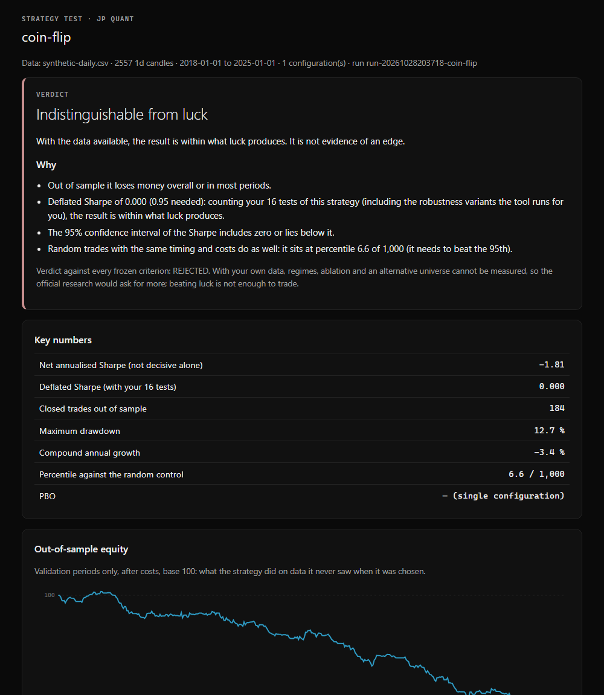
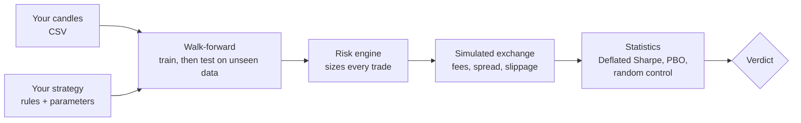

<p align="center"></p>

# JP Quant

**A tool to check honestly whether a trading strategy has a real edge or is just luck.**



**Live demo:** <https://juliuspani.github.io/jp-quant/>, in English, or [in Spanish](https://juliuspani.github.io/jp-quant/es/). It runs in your browser: no install, no keys, no money.

It does not promise returns and it is not financial advice.

[](https://github.com/juliuspani/jp-quant/actions/workflows/ci.yml)
[](https://github.com/juliuspani/jp-quant/actions/workflows/ci.yml)
[](LICENSE)

## Why

- **Most backtests lie by accident.** They peek at the future, forget costs, or keep the one setting that happened to
  work out of hundreds tried.
- **Luck looks like skill.** Try enough ideas and one will look great by chance. JP Quant counts every test you run and
  makes the bar higher each time.
- **A clear answer.** Instead of a pile of metrics you get a verdict in plain words: *looks like a real edge*,
  *indistinguishable from luck* or *not enough data*, and why.

## Test your strategy in 5 steps

These commands work the same on Windows, macOS and Linux.

**1.** Install [Node.js 24 or later](https://nodejs.org/) and [Git](https://git-scm.com/).

**2.** Download the project:

```bash
git clone https://github.com/juliuspani/jp-quant.git
```

```bash
cd jp-quant
```

**3.** Install it (no install scripts are run):

```bash
npm ci --ignore-scripts
```

**4.** Try it on the example data, which is included, with a strategy that trades at random on purpose:

```bash
npm run test-strategy -- --strategy examples/coin-flip.ts --data examples/candles/synthetic-daily.csv
```

It takes a few seconds. The last line tells you where the HTML report is: open it in your browser. The verdict should
be *indistinguishable from luck*. If a coin flip ever passed, the test itself would be broken.

**5.** Test your own idea. Copy [`examples/my-strategy.ts`](examples/my-strategy.ts), change its rules and parameters
(the comments explain each part) and run it on your own candles:

```bash
npm run test-strategy -- --strategy examples/my-strategy.ts --data my-candles.csv
```

Your CSV needs the columns `time,open,high,low,close,volume`, one closed candle per row. If something is wrong, the
error message gives the line number and what to fix. No data of your own? Download public candles from Kraken, with no
account and no API key:

```bash
npm run fetch-candles -- --pair XBTEUR --interval 1d --out my-candles.csv
```

That gives the last 720 candles. They are for your own use (CSV files in the project folder are ignored by Git, so
they are not uploaded by mistake). 720 daily candles are a short history: a slow strategy like the template needs more,
so expect *not enough data* until you test it on a longer CSV of your own. Your runs stay on your computer
(`sandbox-runs/`). They never touch the project's official research registry.

## What you get



- **The verdict and why**, in plain words.
- **Key numbers:** net Sharpe, Deflated Sharpe with *your* number of tests, trades, drawdown, growth and where you sit
  against 1,000 random-trade simulations.
- **The out-of-sample equity curve:** only periods the strategy never saw when it was chosen.
- **The 15 frozen criteria** the project uses for its own research, with PASS, FAIL or INCONCLUSIVE.

## How it works



Each period, the strategy is tuned on past data only and judged on the next stretch it has not seen. Costs are always
charged, and the strategy only ever sees closed candles. The results then face three luck tests:
- the **Deflated Sharpe**, which raises the bar with every test you have run;
- the **probability of overfitting (PBO)**, when you try several parameter sets;
- **1,000 random strategies** with the same trades and costs.

It is the same pipeline the project used for its own study.

## Results: the project's own study

The project tested two classic strategies on Kraken EUR pairs, with daily candles from 2017 to 2026 in ten walk-forward
periods.

*Net Sharpe alone is misleading: read the Deflated Sharpe and the verdict. No strategy was approved.*

| Verdict | Strategy | Experiment | Deflated Sharpe (family · global; needs ≥ 0.95) | Max drawdown (needs ≤ 10 %) | Trades (needs ≥ 100) | Net Sharpe (not decisive) |
|---|---|---|---|---|---|---|
| **REJECTED** | Donchian trend following | [EXP-0027](docs/research/experiments/EXP-0027.md) | 0.48 · 0.39 | 20.5 % | 79 | 1.47 |
| **REJECTED** | RSI(2) mean reversion | [EXP-0028](docs/research/experiments/EXP-0028.md) | 0.14 · 0.07 | 1.4 % | 38 | 0.41 |
| **REJECTED** (reproduction) | Donchian trend following | [EXP-0030](docs/research/experiments/EXP-0030.md) | 0.44 (family *N* = 183) | 20.5 % | 79 | 1.47 |

- **The trend strategy looked good:** it beat buy-and-hold BTC and 99.9 % of its random controls. It still failed five
  criteria. Its edge does not survive the number of tests behind it, its drawdown doubled the cap, and it had too few
  trades. Most of its profit came from one year (2017) and one coin (ETH).
- **Mean reversion failed seven criteria.** Its result could not be told apart from zero.
- **The backtest is reproducible:** re-running it (EXP-0030) gave byte-for-byte identical journals.
- **I changed the criteria once, after seeing results** ([ADR 0030](docs/adr/0030-criterios-congelados.md), decision 9).
  Both strategies fail under either version.

**Conclusion:** no edge was found, and active trading development stopped. The details are in
[docs/DECISION_POINT.md](docs/DECISION_POINT.md).

## Demo and Autopilot

```bash
npm run demo
```

This opens the research console at `http://127.0.0.1:8790/`: a deterministic replay on synthetic prices through the real
pipeline (Strategy → Risk → Execution against a simulated exchange), plus the study's real experiment registry.

```bash
npm run demo:autopilot
```

The **Autopilot** is passive DCA & rebalancing, in paper only. It buys a fixed amount every week towards a target
allocation and rebalances when an asset drifts. It does not try to beat the market. Every order is sized and signed by
the risk engine, and each position keeps a protective stop. The allocation in the demo is an example, not a
recommendation.

## Safety

The full list, each item with a test or a written procedure, is in
[SECURITY_AND_TRADING_INVARIANTS.md](SECURITY_AND_TRADING_INVARIANTS.md).

- **Risk cannot be bypassed.** Every order goes Strategy → Risk → Execution, with an approval signed by the risk engine
  that expires in seconds. No language model can place orders.
- **Paper by default.** Real money needs a production environment, an exact confirmation phrase typed by a person and
  exchange keys. This public repository has no live configuration.
- **Spot only, no leverage, no withdrawals.** A non-spot market or leverage stops the process at startup, and the startup
  guard refuses a key with margin or withdrawal permission (reading those permissions from the exchange is still to be
  wired).
- **Fail closed.** Missing data, a stale price or an unexplained order state stops trading instead of guessing.
- **Kill switch:** it trips on logging failures or a bad approval and blocks trading for the rest of the run.
- **Still to build:** the capital guard (a separate process that would hold the trading key) and drawdown breakers.
  This is one reason live trading stays blocked.

**Known issue:** an exit order that fails to fill leaves the position without a protective stop until the next candle
([#1](https://github.com/juliuspani/jp-quant/issues/1)). It only affects backtests and paper today.

## Project story

I'm a student, and this is how it went, in short. The long version is in [STORY.md](STORY.md).

1. **September 2026, the idea.** I wanted a small bot to trade crypto for me. I had a first version, but an audit showed
   it was neither safe enough nor testable, so I kept it aside and started again.
2. **Rules before strategies.** Before writing a single strategy, I wrote down what the system could never do: trade
   without passing risk checks, use leverage, withdraw money, or peek at future data. Losing less mattered more than
   winning.
3. **Building with AI agents, under control.** I built it with AI coding agents. They worked inside written rules, with
   automatic checks that block anything dangerous, read-only reviewers and a stop at every step until I approved it.
   The method is now a beginner template: [From Zero to Repo](https://github.com/juliuspani/from-zero-to-repo).
4. **A backtester I could trust.** Next came historical data with no look-ahead, real costs and a replay that gives the
   same result every time, plus a registry where every test is written down before it runs, failed ones included.
5. **The first results, and a bug.** Two classic strategies were tested against criteria frozen in advance. An internal
   audit found a bug in the first round; I fixed it and re-ran everything, and the failed runs still counted.
6. **22 October: the honest "no".** The best strategy had a Sharpe of 1.47 and still failed: its edge did not survive the
   number of tests behind it. I stopped building the trading side.
7. **28 October: turning it into a tool.** The checks that stopped me from fooling myself are the useful part. So I
   published them as a tool anyone can run on their own strategy, with a demo, the full study and this repository.

## Roadmap

- **v1.1 (this release):** test your own strategy (`npm run test-strategy`); the research console and the study; the
  Autopilot (passive DCA & rebalancing) **in paper only**.
- **v1.2:** the Autopilot running automatically with real money. It does not try to beat the market, and it will only be
  switched on after passing its own safety checks: the capital guard, the pre-live gate and the manual procedures in
  [SECURITY_AND_TRADING_INVARIANTS.md](SECURITY_AND_TRADING_INVARIANTS.md).

## Contribute

Try your own strategies and tell me what the tool says, or where it confused you: open an
[issue](https://github.com/juliuspani/jp-quant/issues/new/choose). Don't attach market data: its licence does not allow
it. To help with the code, look for issues labelled
[good first issue](https://github.com/juliuspani/jp-quant/labels/good%20first%20issue) and read
[CONTRIBUTING.md](CONTRIBUTING.md). Some good first ideas:
- more example strategies;
- an English translation of a document;
- an extra feature for strategies, such as Bollinger bands.

## Docs

- [docs/README.md](docs/README.md) is an English guide to the documentation, which is in Spanish.
- [ARCHITECTURE.md](ARCHITECTURE.md), [docs/adr](docs/adr) (architecture decisions) and [CLAUDE.md](CLAUDE.md) (the rules
  the AI agents worked under) describe how the system is built.
- **To repeat the study:** download Kraken's data yourself, as described in [DATA.md](DATA.md) §4, and run
  `npm run backtest -- --spec <spec.json>` with a specification from `docs/research/experiments/specs/`.
- **Two commands do not work in this public copy, and that is expected:**
  - `npm run reproduce` checks out each experiment's recorded commit, and those commits are in the private history;
  - `npm run pbo-ronda` needs the full experiment outputs, and the published ones are reduced so that no Kraken prices
    can be derived from them.
- **Engineering checks:** `npm run check:all` runs the build, typecheck, lint, module boundaries and about 800 tests.

## License

[MIT](LICENSE), © Julián Paniagua Sánchez-Brunete.

## Resumen en español

JP Quant es una herramienta para comprobar con honestidad si una estrategia de trading tiene una ventaja real o es
suerte. Prueba tu estrategia con un solo comando
(`npm run test-strategy -- --strategy examples/my-strategy.ts --data tus-velas.csv`). La herramienta la pasa por el
mismo proceso que usó el estudio del proyecto: walk-forward, costes, Deflated Sharpe, PBO y 1000 controles aleatorios.
El resultado es un informe con un veredicto en lenguaje llano: *parece ventaja real*, *no se distingue de la suerte* o
*datos insuficientes*. Tus pruebas se quedan en tu ordenador y no tocan el registro oficial.

El estudio del propio proyecto no encontró ninguna estrategia aprobada, y el backtest se reprodujo byte a byte
(EXP-0030 frente a EXP-0027). El Autopilot (DCA pasivo y rebalanceo) funciona solo en paper; su ejecución real llegará en
la v1.2, tras superar sus comprobaciones de seguridad.

**No es asesoramiento financiero ni promete rentabilidad.**
