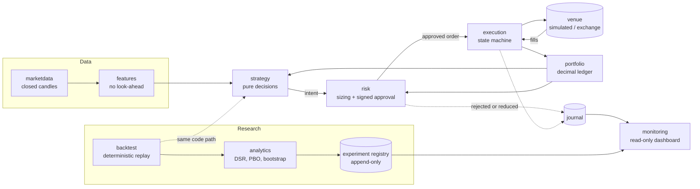

# JP Quant


A quantitative research platform for crypto, built by Julián Paniagua Sánchez-Brunete with AI coding agents under strict rules.
It pre-registers every strategy, backtests it point-in-time with realistic costs, and judges it against criteria frozen in advance.
Its research found no strategy worth trading, and this repository says so, with the evidence.

[](https://github.com/juliuspani/jp-quant/actions/workflows/ci.yml)
[](https://github.com/juliuspani/jp-quant/actions/workflows/ci.yml)
[](LICENSE)

**Live demo:** <https://juliuspani.github.io/jp-quant/> (a static page with synthetic data: no server, no keys, no money).

> **Not financial advice.** This is a research and engineering project. It does not recommend any investment, and
> nothing here promises returns. Its own research concluded that none of the strategies it tested should be traded.

## Run the demo

You need Node.js 24 or later.

```bash
git clone https://github.com/juliuspani/jp-quant.git && cd jp-quant
npm ci --ignore-scripts
npm run demo
```

`npm run demo` runs a deterministic replay on synthetic prices through the real pipeline (Strategy → Risk → Execution
against a simulated exchange), builds the dashboard and opens it at `http://127.0.0.1:8790/`. The server only serves that
read-only page on your machine. Use `npm run demo -- --static site` to write the same page as a static file. The
dashboard's labels are in Spanish, the project's working language.

## Plan B bot: DCA and rebalancing in paper

```bash
npm run demo:dca
```

After the research rejected both strategies, the project switched to a passive plan B. [`demo/dca/`](demo/dca/bot.ts)
shows how to use the execution system for it, on the same synthetic prices:

- a fixed amount every week, split towards a target allocation, and a check every four weeks that sells or buys back
  when an asset drifts more than 3 points from its target;
- every order is an intent that the risk engine sizes and signs, and you can watch it cut purchases that exceed its
  per-trade risk limit;
- each position keeps a protective stop on the exchange. It is only cancelled once Risk has approved the order that
  replaces it.

The allocation (24 % BTC, 16 % ETH, the rest in cash) is an example, not a recommendation. The bot runs in paper only.

## What is in it

| Module | What it does |
|---|---|
| `marketdata/`, `features/` | Closed candles only, with their receive time; features over a fixed window, with no look-ahead |
| `strategy/` | Pure functions that return decisions. A strategy never creates or sends orders |
| `risk/` | Sizes and approves every order, and signs each approval with Ed25519 |
| `execution/` | Order state machine, idempotent client order IDs, `UNKNOWN` state and reconciliation |
| `portfolio/` | Positions and cash in decimal arithmetic (`big.js`), never floating point |
| `backtest/` | Deterministic event-driven replay, simulated venue, costs and latency |
| `analytics/` | Performance and cost metrics, Deflated Sharpe, PBO (CSCV), block bootstrap, regimes, the frozen-criteria evaluator |
| `research/` | Append-only experiment registry with a hash chain; every test counts towards *N* |
| `historical/` | Parquet store, Kraken capture, data quality, point-in-time universe and the final-test lock |
| `monitoring/` | Read-only dashboard over a replay journal and the registry; a self-contained page with a strict CSP |
| `app/` | Composition: the trading system, backtest and research commands |



The same code runs in every mode: the mode only picks the clock, the data source and the venue
([ADR 0013](docs/adr/0013-mismo-codigo-en-todos-los-modos.md)). Module boundaries are enforced by `dependency-cruiser`
and by tests ([ARCHITECTURE.md](ARCHITECTURE.md)).

## Safety principles

Each one is backed by a test or a written manual procedure in
[SECURITY_AND_TRADING_INVARIANTS.md](SECURITY_AND_TRADING_INVARIANTS.md).

- **Risk cannot be bypassed.** Every order goes Strategy → Risk → Execution. Execution only accepts an approval signed by
  the risk engine for that exact order, and an approval expires in seconds. No language model can place orders.
- **Capital guard (capguard).** Designed as a separate process that holds the only trading key and enforces its own caps
  ([ARCHITECTURE.md](ARCHITECTURE.md) §16.10). It is not built yet, which is one reason live trading stays blocked.
- **Kill switch.** The risk engine trips it when it cannot persist a decision or a rejection, or when Execution reports
  a bad signature or a reused approval, and then blocks trading for the rest of the run. Drawdown breakers and an
  authenticated reset channel are designed but not built yet.
- **Fail closed.** Any configuration error, missing data, stale price or unexplained order state stops trading instead
  of guessing.
- **No withdrawals.** There is no withdrawal code, and the startup guard refuses a key with withdrawal or margin
  permission (reading those permissions from the exchange is still to be wired).
- **Spot only, no leverage.** A non-spot market, leverage other than 1 or margin stop the process at startup.
- **Paper by default.** Real money needs `APP_ENV=production`, an exact confirmation phrase typed by a person into an
  environment variable, and exchange keys. Without all three the process refuses to start. This public repository has
  no live configuration.

## Research methodology

The full procedure is in [`.claude/skills/quant-research`](.claude/skills/quant-research/SKILL.md) and the frozen
criteria in [docs/PROMOTION_CRITERIA.md](docs/PROMOTION_CRITERIA.md).

- **Pre-registration.** Hypothesis, parameters, universe, costs and criteria go into the registry before any result is
  seen. Failed, aborted and invalidated tests also count towards *N*.
- **Point-in-time data.** Candles are used at their receive time, with a delisting-aware universe and documented
  survivorship bias ([DATA.md](DATA.md)).
- **Real costs.** Commission, half spread and slippage in every backtest; a backtest without costs does not start.
- **Walk-forward** with purging and embargo, parameters chosen on train only.
- **Locked final test.** The out-of-sample period is fixed in `config/holdout.lock`, and research code cannot load it
  without a human-signed unlock.
- **Deflated Sharpe Ratio** with the family *N* and the global *N*, and a long-run variance of the Sharpe ratio.
- **Probability of Backtest Overfitting** (CSCV) over every configuration that competed in the round.
- **Negative controls.** A random strategy with the same trades, durations and costs (1,000 simulations), a shifted
  signal and a random walk all have to come out null.

## Results

Two strategies taken from the literature were tested on Kraken EUR pairs, with daily candles from 2017-01-01 to
2026-09-30 in ten walk-forward folds:

| Strategy | Experiment | Net Sharpe | Deflated Sharpe (family · global) | Max drawdown | Trades | Verdict |
|---|---|---|---|---|---|---|
| Donchian trend following (A) | [EXP-0027](docs/research/experiments/EXP-0027.md) | 1.47 | 0.48 · 0.39 | 20.5 % | 79 | **Rejected** |
| RSI(2) mean reversion (B) | [EXP-0028](docs/research/experiments/EXP-0028.md) | 0.41 | 0.14 · 0.07 | 1.4 % | 38 | **Rejected** |
| Reproduction of A | [EXP-0030](docs/research/experiments/EXP-0030.md) | 1.47 | 0.44 (family *N* = 183) | 20.5 % | 79 | Same verdict |

The bar was a Deflated Sharpe of at least 0.95, a drawdown of at most 10 %, at least 100 trades and a pass on stress,
regime and parameter-stability tests ([docs/DECISION_POINT.md](docs/DECISION_POINT.md)).

- **A** beat its random control (99.9th percentile) and buy-and-hold BTC on Sharpe and Calmar. It still failed five
  criteria. Its Sharpe does not survive the number of tests behind it, its drawdown doubles the cap, and its sample is
  too small. It also failed in the 2020 crash and in the 2022 bear market, and most of its profit came from 2017 and ETH.
- **B** failed seven criteria. Its Sharpe cannot be told apart from zero, and its sign flips when one parameter moves
  by 50 %.
- **Reproducibility.** EXP-0030 re-ran A's backtest from its specification. The journals of all ten folds came out byte
  for byte identical to EXP-0027's, with the same verdict, criteria and PBO. Only the metrics that depend on the number
  of tests changed (the family *N* went from 153 to 183), because re-running a test counts as another test.
- **One caveat.** The criteria were changed once, by the person, after seeing the first round's results
  ([ADR 0030](docs/adr/0030-criterios-congelados.md), decision 9). Both strategies are rejected under either version.

**Conclusion.** Nothing here is evidence of an edge. Active trading development stopped at the decision point
(2026-10-22). What remains is the engineering: a pipeline that makes it hard to fool yourself with a backtest.

## Run the real research

Market data is not included: Kraken's terms do not allow redistribution. To repeat the research, download the data
yourself (see [DATA.md](DATA.md) §4 and §5):

```bash
node scripts/download-kraken.ts Kraken_OHLCVT_Full_2026Q2.zip.part00
```

```bash
node scripts/capture-kraken.ts --zip <zip> --label full2026q2 --url <source url> --retrieved <ISO UTC time>
```

```bash
npm run backtest -- --spec docs/research/experiments/specs/tendencia-donchian-1.0.0-rejilla-repeticion.json
```

The backtest command pre-registers the experiment, runs the walk-forward and writes the criteria report next to the
registry (`EXP-NNNN.md`, one PASS or FAIL per frozen criterion). Running it adds to *N*. To view the registry, the
criteria funnel and a run's journal:

```bash
npm run dashboard -- --diario <journal.jsonl> --ficha <card.json> --salida local.html --registro docs/research/experiments/registry.jsonl
```

Pages built from real data stay on your machine; this repository only publishes the synthetic demo.

**Expected limitation, not a bug:** two commands do not work in this public copy.
- `npm run reproduce` checks out each experiment's recorded commit, and those commits belong to the private history.
- `npm run pbo-ronda` needs the full experiment outputs. The published outputs are reduced so that no Kraken prices can
  be derived from them.

The reproduction itself was checked in the private history; see EXP-0030.

## Engineering checks

```bash
npm run check:all
```

It runs the build (`node --check` on every file; Node runs TypeScript natively), the strict typecheck, ESLint with
custom rules (no floating point in money modules, no wall clock in deterministic modules), the module-boundary rules
and about 760 tests. CI runs it on every push and pull request, together with a secret scan.

## How it was built

Step by step, with AI coding agents working under a written constitution ([CLAUDE.md](CLAUDE.md)), domain skills
([.claude/skills](.claude/skills)), read-only review agents ([docs/CONSULTANTS.md](docs/CONSULTANTS.md)) and hooks that
block dangerous commands. Every non-trivial decision has an ADR ([docs/adr](docs/adr)). [STORY.md](STORY.md) tells the
story, including the negative results.

## Roadmap

- **v1.0 (this release):** the research platform, the read-only console and the study, with its negative result.
- **v1.1:** an automatic passive investor. It will make regular purchases and rebalance towards a target allocation,
  and it does not try to beat the market. It will start in paper mode. It will only move to real money after passing
  its own safety checks: the capital guard, the pre-live gate and the manual procedures in
  [SECURITY_AND_TRADING_INVARIANTS.md](SECURITY_AND_TRADING_INVARIANTS.md).

## Documentation

The documentation is in Spanish. [docs/README.md](docs/README.md) is an English guide to it.

## Resumen en español

JP Quant es una plataforma de investigación cuantitativa en cripto, hecha por una persona con agentes de IA bajo reglas
estrictas. Cada estrategia se registra antes de probarla, se prueba sin mirar al futuro y con costes reales, y se juzga
con criterios fijados de antemano. Las dos estrategias candidatas, la de tendencia y la de reversión, quedaron
rechazadas. El backtest de la de tendencia se reprodujo byte a byte (EXP-0030 frente a EXP-0027). La demo
(`npm run demo`) usa datos sintéticos. **No es asesoramiento financiero ni promete rentabilidad.**

## License

[MIT](LICENSE).
